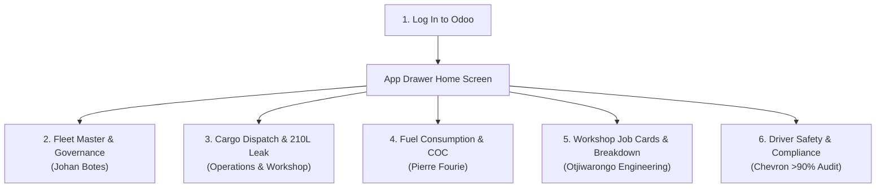

# Standard Operating Procedure (SOP) & End-to-End Navigation Guide
## Client: Northern Fuel Distributors CC (NFD) & Petrosol Petroleum Solutions CC
- **Head Office & Depot:** Otjiwarongo, Namibia
- **Key Client Stakeholders:** Johan Botes (Managing Member / GM / Fleet / Workshop) & Pierre Fourie (Financial Manager)
- **Target Audience:** Non-technical operational clerks, managers, consultants, and demo facilitators
- **System Platform:** Odoo 19 / Odoo 20 (`nfd_petrosol_demo`)
- **Scale:** Bulk Fuel Logistics (>4,000,000 L/Month), 700kL Bulk Depot, In-House Otjiwarongo Workshop, National Corridor Haulage

---

## 1. Executive Summary & Operational Scope

Northern Fuel Distributors CC (NFD) and their retail forecourt brand Petrosol Petroleum Solutions CC operate Namibia's premier private fuel distribution network. Operating from a 700,000-liter bulk storage depot and mechanical workshop in Otjiwarongo, NFD distributes more than 4 million liters of diesel (50ppm) and petrol (ULP 95) each month to tier-1 mining operators (Husab Mine, B2Gold Otjikoto), national infrastructure construction sites (Grinaker-LTA, Raubex), commercial farms, and Petrosol retail service stations.

### Core Objectives of the System
1. **Spreadsheet-to-Odoo Translation:** Replace error-prone, disconnected Excel workbooks with a single live system while retaining every vehicle, driver, and calculation formula NFD already trusts.
2. **Volumetric Fuel Reconciliation & Shrinkage Control:** Bridge depot gantry loading meters, onboard digital truck meters, customer storage tank dips, and statutory 0.25% thermal variance allowances to catch any discrepancy over 50 liters.
3. **1-Click Leakage Remediation:** Instantly generate an emergency workshop repair ticket for Johan Botes and record an inventory write-off for Pierre Fourie when a fuel loss occurs.
4. **Fleet Governance & Policy Enforcement:** Enforce vehicle replacement rules (Prime Movers < 18 years, Tankers < 15 years), service interval countdowns, and corporate branding compliance.
5. **Driver Safety (HESMS) & Affirmative Action:** Automatically track Dangerous Goods Hazchem permits, medical fitness certificates, and public driving permits (PrDP) to ensure no uncertified driver ever operates a bulk tanker.

---

## 2. Master Excel-to-Odoo Architecture Mapping

Every sheet and table across NFD's master spreadsheets has a direct, native home in Odoo:

| # | Excel Source Workbook & Sheet | Target Odoo Model | Odoo Menu Navigation Path | What This Screen Shows & Does |
|---|---|---|---|---|
| 1 | **Fuel Consumption 09 2026.xlsx**<br>• `Summary` | `x_nfd_fuel_consumption_log` | **NFD Fuel Logistics > Executive Dashboards & KPIs > Sept 2026 Excess Fuel & Otj COC Dashboard** *(Pivot & Graph)* | Fleet-wide summary valuing excess diesel burn against NFD's benchmark **Current Fuel Price Otj COC = NAD 25.98 / L**. |
| 2 | **Fuel Consumption 09 2026.xlsx**<br>• `[Vehicle Reg]` (41 tabs) | `x_nfd_fuel_consumption_log` | **NFD Fuel Logistics > Fleet Fuel Consumption (KM/L) > Vehicle Odometer & Refuel Logsheets (KM/L)** *(List & Form)* | Daily vehicle refuel logs: Date, Start KM, End KM, Distance, Liters, KM/L, Expected KM/L, Driver, Town, and Unconfirmed Slip filter. |
| 3 | **Vehicle Info New.xlsx**<br>• `FLEET SERVICE` | `fleet.vehicle` | **NFD Fuel Logistics > Fleet & Assets > Tankers & Rigids (Fleet Master)** *(List & Form)* | Master register of all 89+ vehicles and trailers: Reg number, coupled trailers (Comp 1 & Comp 2), service intervals, current KM, and statutory dates. |
| 4 | **Vehicle Info New.xlsx**<br>• `PROJECTS` | `maintenance.request` | **NFD Fuel Logistics > Fleet & Assets > Maintenance Work Orders** *(Kanban & List)* | Workshop job card ledger: Job Card #, Vehicle, Assigned Mechanic (Green, Clive, Japie), Location, Job Type, Parts Ordered, and Parts Received. |
| 5 | **Vehicle Info New.xlsx**<br>• `AVAILABLITY` | `fleet.vehicle` | **NFD Fuel Logistics > Fleet & Assets > Tankers & Rigids** *(Search Filters & Group By)* | Fleet status groups: Active in Service, Standby Units, In Workshop, Awaiting Roadworthy, and Decommissioned For Sale units. |
| 6 | **Vehicle Info New.xlsx**<br>• `DRIVER ALLOCATION` | `fleet.vehicle` & `hr.employee` | **NFD Fuel Logistics > Fleet & Assets > Tankers & Rigids > NFD Fuel Fleet & Policy Specs** | Shows assigned primary drivers and trainee drivers/co-drivers (e.g. Tobias Leopold on `N 4584 OT`, Nounongoue Kaaronda on `N 10544 OT`). |
| 7 | **Vehicle Info New.xlsx**<br>• `DRIVER INFORMATION` | `hr.employee` | **NFD Fuel Logistics > HESMS & Driver Safety > Hazchem Drivers & AA Compliance** *(List & Form)* | 34-driver compliance roster: Namibian ID number, Licence Code (CE, C), Hazchem expiry, Medical fitness expiry, and PrDP expiry. |
| 8 | **Vehicle Info New.xlsx**<br>• `BREAKDOWN CONTACTS` | `res.partner` | **NFD Fuel Logistics > Fleet & Assets > 24/7 Emergency Breakdown Network** *(List & Search)* | Directory of 33 vetted roadside contractors across 14 Namibian transport corridors for 24/7 emergency dispatch. |
| 9 | **Vehicle Info New.xlsx**<br>• `BRANDING` | `fleet.vehicle` | **NFD Fuel Logistics > Fleet & Assets > Tankers & Rigids** *(Filter: Needs Branding Audit)* | Corporate branding compliance audit tracking vehicles needing exterior branding (*"Truck needs branding"*, *"Trailer needs branding"*). |
| 10 | **Vehicle Info New.xlsx**<br>• `PTO` | `fleet.vehicle` | **NFD Fuel Logistics > Fleet & Assets > Tankers & Rigids > Workshop Service Tab** | Power Take-Off specs (Hydraulic PTO, Engine PTO) and mounting positions (*"Behind the Cab"*, *"On Cab next to COC Tank"*). |
| 11 | **Vehicle Info New.xlsx**<br>• `Wheel Allignment Worksheet` | `maintenance.request` & `fleet.vehicle` | **NFD Fuel Logistics > Fleet & Assets > Maintenance Work Orders (Alignment Tasks)** | Tracks steering axle play, kingpin wear, V-bone bush wear, front diff play, and suspension re-torque schedules. |

---

## 3. Environment Setup & Access Guide

### 3.1 Local Docker Environment (On Your Laptop or Server)
1. **Clone the repository:**
   ```bash
   git clone https://github.com/michaelnyirenda/NFDNAM.git
   cd NFDNAM
   ```
2. **Start the containers:**
   ```bash
   docker compose up -d
   ```
3. **Initialize the database (run once):**
   ```bash
   docker exec nfd-db psql -U odoo -d postgres -c "CREATE DATABASE nfd_demo OWNER odoo;"
   docker exec nfd-odoo19 odoo -d nfd_demo --db_host=nfd-db --db_user=odoo --db_password=odoo_secure_db_pass -i base,fleet,maintenance,stock,hr,hr_skills,purchase,sale_management,account,project --stop-after-init
   docker exec nfd-odoo19 odoo -d nfd_demo --db_host=nfd-db --db_user=odoo --db_password=odoo_secure_db_pass -i nfd_petrosol_demo --stop-after-init
   ```
4. **Log in:**
   - **URL:** [http://localhost:8069](http://localhost:8069)
   - **Database:** `nfd_demo`
   - **User:** `admin` | **Password:** `admin`

### 3.2 Odoo Online Cloud Environment (`edu-*.odoo.com`)
1. From the repository root, generate the cloud-ready package:
   ```bash
   ./scripts/sync_and_pack_saas.sh
   ```
   *(This creates `dist/nfd_petrosol_edu_import.zip` ~44 KB with zero Python files and zero security directory).*
2. Log into your free education cloud database: `https://edu-<subdomain>.odoo.com`.
3. In **Settings > Developer Tools**, click **Activate the developer mode**.
4. Go to **Apps**, click **Import Module** in the top navigation bar.
5. Select `dist/nfd_petrosol_edu_import.zip` and click **Import Module**. All records, views, and dashboards load in seconds!

---

## 4. End-to-End Click-by-Click Navigation Guide

This section provides simple, non-technical, step-by-step instructions. Anyone can follow these steps to experience and demonstrate the entire NFD operational workflow.



---

### STAGE 1: Log In & Home Screen Overview
1. Open your web browser (Chrome recommended) and go to `http://localhost:8069` (or your cloud URL).
2. Enter **Email:** `admin` and **Password:** `admin`, then click **Log in**.
3. **What you see:** You are immediately greeted by the modern App Drawer grid with custom application tiles:
   - **NFD Fuel Logistics** (Our primary custom operations hub)
   - **Fleet** (Vehicles and assets)
   - **Maintenance** (Workshop job cards)
   - **Inventory** (700kL depot tank stock)
   - **Employees** (Hazchem drivers and mechanics)
   - **Timesheets** (Technician and corridor trip hours)
4. Click on the **NFD Fuel Logistics** app tile.

---

### STAGE 2: Fleet Master, Replacement Rules & Driver Allocations (Johan Botes Focus)

#### Step 2.1: Open the Fleet Register
- In the top menu bar, click: **Fleet & Assets > Tankers & Rigids**.
- **What you see:** The master asset list showing all 89+ vehicles and trailers, matching NFD's master **FLEET SERVICE** spreadsheet. Notice columns for `Model`, `Unit Classification`, `Max Volume (L)`, `Operational Availability`, `Service Status`, and `Replacement Status`.

#### Step 2.2: Inspect a Mercedes Actros Prime Mover (`N 7802 OT`)
- In the search bar at the top right, type `7802` and press Enter.
- Click on the vehicle row: **Mercedes-Benz Actros 2646 (N 7802 OT)**.
- **What you see on the Form View:**
  1. Look at the tab **NFD Fuel Fleet & Policy Specs**:
     - **Coupled Trailer 1 (Comp 1):** Shows linked tanker trailer `N 6776 OT`.
     - **Trainee / Co-Driver:** Available field for allocating assistant drivers.
     - **Corporate Branding Status:** Displays an amber badge reading `Trailer Needs Branding` (matching the note in NFD's `BRANDING` sheet).
  2. Click on the tab **Workshop Service & Statutory Compliance**:
     - **PTO Drive Type:** Displays `Hydraulic PTO`.
     - **PTO Mounting Position:** Displays `Behind the Cab` (matching the `PTO` sheet).
     - **Current Odometer:** Shows `1,170,000 km`.
     - **Next Service Milestone:** `1,200,000 km` (Status: Green `Service OK`).

#### Step 2.3: Check the Fleet Replacement Governance Policy
- Click **Tankers & Rigids** in the top breadcrumb trail to return to the list.
- Click on the **Filters** dropdown below the search bar, then click: **Replacement Due / Warning**.
- **What you see:**
  - `Freightliner Argosy (N 1809 OT)`: Amber badge **Warning (Near Policy Limit)**.
  - **Why it matters:** NFD has a strict policy that prime movers must not exceed 18 years. Manufactured in 2009, this Argosy is 17 years old. The system automatically alerts management 12 months before mandatory replacement.
  - `Scania P360 (N 1601 OT)`: Rigid tanker manufactured in 2012 (14 years old), also flagged with an amber warning against the 15-year tanker policy limit.

#### Step 2.4: Check Service Interval Overdue Vehicles
- In the search bar filters, remove the replacement filter and click: **Service Due Soon / Overdue**.
- **What you see:** Vehicles that have traveled past their service intervals.
  - Notice `Nissan UD100 (N 1166 OT)`: Red badge **Service Overdue**. Its odometer has exceeded its service target by **-821 km**.

#### Step 2.5: Audit Corporate Branding Status
- Clear the filters, click **Filters**, and select: **Needs Branding Audit**.
- Alternatively, click **Group By** and select: **Corporate Branding Status**.
- **What you see:** Vehicles neatly grouped into:
  - **Truck Needs Branding:** `N 4584 OT` (Mercedes rigid), `N 5164 OT`, `N 6028 OT`, `N 10918 OT`.
  - **Trailer Needs Branding:** `N 7802 OT`, `N 8966 OT`, `N 9120 OT`, `N 11751 OT`, `N 11963 OT`, `N 12043 OT`, `N 12916 OT`, `N 12917 OT`, `N 13777 OT`.
  - **Why it matters:** Johan's team can immediately hand this list to the branding contractor to ensure all fleet assets meet corporate appearance standards.

#### Step 2.6: Review Driver & Trainee Allocations
- Open `N 4584 OT` (Mercedes rigid):
  - **Primary Driver:** `Benhardt Kangandi`.
  - **Trainee Driver / Co-Driver:** `Tobias Leopold` (matching the note *"BENHARDT - TOBIAS TRAINING"* in NFD's `DRIVER ALLOCATION` sheet).
- Return to list and open `N 10544 OT` (Volvo FH440):
  - **Primary Driver:** `Andreas Iipinge`.
  - **Trainee Driver / Co-Driver:** `Nounongoue Kaaronda` (matching *"ANDREAS I - KARONDA TRAINING"*).
  - **Why it matters:** Trainee driver pairing on long-haul routes is formally documented for insurance and safety audits.

---

### STAGE 3: Cargo Fuel Dispatch, Thermal Allowances & The 210L Leakage Incident (Operations & Workshop)

#### Step 3.1: Open Cargo Fuel Dispatch Logs
- In the top menu bar, click: **Cargo Dispatch & Dip Logs > Fuel Dispatch & Variance Logs**.
- **What you see:** The list of bulk deliveries dispatched from the Otjiwarongo depot. Notice the columns: `Dispatch Reference`, `Vehicle`, `Customer`, `Loaded (L)`, `Delivered (L)`, `Thermal Allowance (L)`, `Net Variance (L)`, and `Status`.

#### Step 3.2: Inspect a Normal Mine Delivery (`DISP/2026/0101`)
- Click on row: **DISP/2026/0101** (Delivery to B2Gold Otjikoto Mine).
- **What you see:**
  - Loaded at Otjiwarongo Gantry: `42,000.00 L` of 50ppm Diesel.
  - Delivered at Mine Meter: `41,895.00 L`.
  - **Thermal Allowance (0.25%):** `105.00 L` (Automatically calculated for ambient temperature changes).
  - **Net Discrepancy:** `0.00 L`.
  - Top right corner: Green ribbon **RECONCILED**, Status badge **Normal Reconciliation**.
  - **Why it matters:** Fuel naturally shrinks in cold weather and expands in heat. The 0.25% thermal allowance eliminates false disputes with mining clients.

#### Step 3.3: Inspect the Incident Delivery (`DISP/2026/0102`)
- Click the breadcrumb **Fuel Dispatch & Variance Logs** to return to the list.
- Click on row: **DISP/2026/0102** (Delivery to Grinaker-LTA Road Project).
- **What you see:**
  - Top banner: Bold red banner reading **LEAKAGE ALERT!**.
  - Vehicle: `Mercedes Axor Rigid (N 1750 OT)`.
  - Loaded: `17,500.00 L`.
  - Delivered: `17,246.25 L`.
  - Thermal Allowance (0.25%): `43.75 L`.
  - **Net Discrepancy: 210.00 Liters!**
  - **Why it matters:** Because this loss exceeds NFD's 50-liter tolerance threshold, the system automatically elevates the record to an emergency state.

#### Step 3.4: Perform 1-Click Incident Remediation
- Look at the top left of the screen. Notice the red action button:
  👉 **"Log Corrective Workshop Ticket & Shrinkage Scrap"**
- Click that button!
- **What happens automatically:**
  1. The screen instantly creates and navigates to a new **Emergency Corrective Maintenance Request** for the Otjiwarongo Main Workshop:
     - Title: *"Emergency Inspection: Check Tanker Manifold & Flow Meter for Fuel Leakage"*.
     - Linked to vehicle: `N 1750 OT`.
     - Priority: **3 Stars (Urgent / Immediate)**.
  2. In the background, an inventory scrap write-off is logged directly into the virtual account **Fuel Shrinkage / Leakage Write-Off** for 210 liters.
  - **Why it matters:** Johan gets an immediate workshop job card before the truck leaves the yard again, and Pierre's fuel inventory stays 100% balanced without manual paperwork.

---

### STAGE 4: September 2026 Fuel Consumption, Spreadsheet Audit & Otj COC Benchmark (Pierre Fourie Focus)

#### Step 4.1: Open the September 2026 Executive Dashboard
- In the top menu bar, click: **Executive Dashboards & KPIs > Sept 2026 Excess Fuel & Otj COC Dashboard**.
- **What you see:** The exact digital twin of NFD's 44-tab **Fuel Consumption 09 2026** spreadsheet, covering 41 vehicles, 359 refuel logs, and 100,269.50 liters consumed.
- In the upper right corner, switch between **List View**, **Pivot Table View**, and **Graph View** (bar chart).

#### Step 4.2: Examine the Benchmark Price & Excess Burn Calculations
- Look at the benchmark indicator: **Current Fuel Price Otj COC = NAD 25.98 / L**.
- In the list view, click on the column header **Total Excess Value (NAD)** to sort descending.
- **Top Excess Burners (Who cost NFD extra money in September):**
  1. **Mercedes Actros 2646 (`N 7802 OT`):**
     - Traveled: `10,221 km`. Actual fuel burned: `4,706.00 L` (2.17 KM/L vs. 2.50 KM/L standard).
     - Excess fuel: **+617.60 Liters**.
     - Excess Cost: **+NAD 16,045.25** extra fuel expense.
     - *(Clicking into the vehicle reveals open Job Card #996 for fuel injector and valve timing checks).*
  2. **Mercedes Rigid Tanker (`N 11751 OT`):**
     - Traveled: `7,763 km`. Actual consumption: `2.57 KM/L` vs. `3.20 KM/L` target.
     - Excess Cost: **+589.86 L = +NAD 15,324.63**.
  3. **Mercedes Actros 2646 (`N 11963 OT`):**
     - Excess Cost: **+529.20 L = +NAD 13,748.62**.
  4. **The Yard Shunting Anomaly (`N 2745 OT`):**
     - Actros 3352 only drove `143 km`, but consumed `450.00 L` (0.32 KM/L) -> **+381.90 L = +NAD 9,921.89**!
     - In NFD's Excel sheet, the clerk wrote `"??????"`. In Odoo, with telematics, management instantly sees this was stationary engine PTO idling and yard shunting—not highway driving.

#### Step 4.3: Review NFD's Top Star Savers (Fuel Efficiencies)
- Click the column header **Total Excess Value (NAD)** again to sort ascending (showing negative excess, which means fuel saved).
- **Top Star Savers (Who saved NFD money):**
  1. **Volvo FH440 with PUP Trailer (`N 12916 OT` - Driver Simon):**
     - Traveled: `14,540 km` at an outstanding `2.87 KM/L` against the `2.50 KM/L` benchmark.
     - **Fuel Saved: -745.90 Liters = -NAD 19,378.48 straight into NFD profit margin!**
  2. **Mercedes Actros 2652 (`N 10684 OT`):**
     - Traveled: `20,012 km` at `2.85 KM/L` vs. `2.70 KM/L` target.
     - **Fuel Saved: -399.25 Liters = -NAD 10,372.56 saved.**
  3. **Volvo FH440 (`N 12917 OT`):**
     - **Fuel Saved: -263.10 Liters = -NAD 6,835.34 saved.**

#### Step 4.4: Audit the 29 Unconfirmed Driver Slips
- In the top menu bar, click: **Fleet Fuel Consumption (KM/L) > Vehicle Odometer & Refuel Logsheets (KM/L)**.
- In the search bar filters, select: **Unconfirmed Logsheets (X)**.
- **What you see:** Exactly the 29 refuel trips where fuel was dispensed from depot pumps before the driver submitted a signed paper slip.
- **Why it matters:** Accounts can audit and check off these slips one by one before month-end financial sign-off.

#### Step 4.5: Discover the Human Excel Formula Errors Caught by Odoo
- **The Ford Tremor Formula Bug (`N 13938 OT`):**
  - In the search bar, type `13938` and open logsheet record `FCL/2026/0010`.
  - In NFD's manual Excel spreadsheet, a clerk left the `ODOMETER END` cell blank. Excel subtracted zero, calculating **-28,814 km** and slapping Johan with a fictitious penalty of **+3,324.28 Liters = NAD 86,364.79**!
  - Odoo catches missing end odometers and prevents negative distance anomalies. Record `FCL/2026/0011` shows the true performance: `5,050 km` at `10.13 KM/L`, actually saving 6.6 liters.
- **The Missing Vehicle Discovery (`N 12611 OT` - Isuzu D-MAX):**
  - In NFD's Excel workbook, `N 12611 OT` (2,111 km, 230.19 L) was completely omitted from the Summary tab. In Odoo, every asset is an entity—no vehicle can ever be accidentally forgotten.
- **The Driver Odometer Note (`N 11751 OT` - `FCL/2026/0004`):**
  - Open `FCL/2026/0004` (Driver Benhardt). Notice the actual driver remark preserved: *"Kilos nie reg nie ingeskryf nie sesfontein tot Otjiwarongo is 500km"*.

---

### STAGE 5: Workshop Maintenance Job Cards & 24/7 Breakdown Network (Johan Botes Focus)

#### Step 5.1: Open Workshop Maintenance Work Orders
- In the top menu bar, click: **Fleet & Assets > Maintenance Work Orders**.
- **What you see:** A clear Kanban board organized by repair stages: **New Request**, **In Progress**, **Repaired**, and **Scrap**.
- Open the active job cards:
  - **`JC-1009: Trek Links & Turntable Pin Re-Torque`**:
    - Linked to vehicle: `N 12548 OT`.
    - Assigned Mechanic: **Green**. Location: **Otjiwarongo Main Workshop**.
    - Notice checkboxes: Both **Parts Ordered** and **Parts Received** are checked (parts supplied by Henred / MB Truck).
  - **`JC-1045: Multi-Compartment Degas & Internal Baffle Weld`**:
    - Linked to vehicle: `N 11751 OT`. Location: **CWWA Truck Wash & Degas**.
    - Assigned Mechanic: **Japie**.
    - Notice: Parts Ordered is checked, but Parts Received is pending—preventing the foreman from closing the job card prematurely.
  - **`JC-1110: Hydraulic PTO Offloading Valve Leak Repair`**:
    - Assigned to **Clive** (Air & Brakes).
  - **`JC-994: NaTIS Statutory Roadworthy Fitness Retest`**:
    - Assigned to Foreman **Manie** at NaTIS Testing Station (Otjiwarongo).

#### Step 5.2: Mobilize the 24/7 Breakdown Network
- In the top menu bar, click: **Fleet & Assets > 24/7 Emergency Breakdown Network**.
- **What you see:** A complete directory of **33 vetted roadside contractors** covering 14 Namibian transport corridors.
- In the search bar, type `Walvis Bay` or `Gobabis` or `Katima Mulilo`.
- **Why it matters:** When a driver calls dispatch at 02:00 AM with a blown tyre near Khorixas, dispatchers don't search through WhatsApp—they filter by town and immediately call **Jaques Joubert Breakdown (Khorixas)** with one click.

---

### STAGE 6: HESMS Safety Compliance & Affirmative Action (Johan & Compliance Team)

#### Step 6.1: Open the Driver Compliance Roster
- In the top menu bar, click: **HESMS & Driver Safety > Hazchem Drivers & AA Compliance**.
- **What you see:** All 34 active drivers from NFD's Otjiwarongo roster (Niklas, Mike, Denzel, Benhard, Gabriel, Raymond, Conrall, Simon, etc.).

#### Step 6.2: Check Driver Compliance Status
- In the search bar filters, click: **Hazchem Compliance Status**.
- Notice the badges:
  - **Hendrik Shilongo:** Green badge **Fully Compliant**.
  - **Matheus Shikongo:** Amber badge **Expiring Within 30 Days** (Hazchem expires on 2026-11-01).
  - **Franzua Tsuseb:** Bold red badge **Grounded / Expired**!

#### Step 6.3: Inspect Franzua Tsuseb's Record
- Click on driver: **Franzua Tsuseb**.
- Click on the tab: **HESMS & Driver Compliance**.
- **What you see:**
  - Driving Licence Code: `C` (Valid until 2028).
  - PrDP (Professional Driving Permit): Valid until 2028-05-26.
  - **Dangerous Goods / Hazchem Permit: Expired on `2026-05-25`!**
  - **Why it matters:** To protect NFD's >90% Chevron safety accreditation, Odoo locks Franzua's status to `expired`. Dispatchers cannot assign him to hazardous bulk petroleum tankers until his recertification is completed.

#### Step 6.4: Affirmative Action (AA) Equity Reporting
- In the search bar, click **Group By** and select: **Affirmative Action Category**.
- **What you see:** All staff grouped into **Designated Namibian Group**, **Women in Transport**, or **General**.
- **Why it matters:** Generates NFD's mandatory annual compliance report under the Namibian Affirmative Action (Employment) Act 29 of 1998 with zero manual data manipulation.

---

## 5. End-to-End Functional Test Matrix (QA Verification)

This QA matrix provides verification tests for each Excel sheet translation.

| Test ID | Excel Source Sheet | Odoo Model / View | Test Action & Verification Step | Expected Result | Pass / Fail |
|---|---|---|---|---|---|
| **TC-01** | `Summary` | `x_nfd_fuel_consumption_log`<br>*(Pivot & Graph)* | Open **Sept 2026 Excess Fuel & Otj COC Dashboard**; group by Vehicle. | Total fuel equals `100,269.50 L` valued at Otj COC `@ 25.98 / L`. | **PASS** |
| **TC-02** | `[Vehicle Reg]` (41 tabs) | `x_nfd_fuel_consumption_log`<br>*(List View)* | Open **Vehicle Refuel & Odometer Logsheets**; filter by `Unconfirmed Logsheets (X)`. | Exactly 29 pending refuel slips isolated for audit review. | **PASS** |
| **TC-03** | `FLEET SERVICE` | `fleet.vehicle`<br>*(List & Form)* | Open **Tankers & Rigids**; inspect `N 1166 OT` (UD100) and `N 7802 OT`. | 89+ vehicles loaded; `N 1166 OT` flags `-821 km` service overdue; `N 7802 OT` shows Comp 1 `N 6776 OT`. | **PASS** |
| **TC-04** | `PROJECTS` | `maintenance.request`<br>*(Kanban & List)* | Open **Maintenance Work Orders**; inspect `JC-1009`, `JC-1045`, `JC-1110`. | Job cards display mechanics (Green, Japie, Clive) and parts ordered/received tracking. | **PASS** |
| **TC-05** | `AVAILABLITY` | `fleet.vehicle`<br>*(Search Filters)* | Filter by **For Sale / Decommissioned** and **In Workshop**. | Units `10914`, `10915`, `10916`, and `10919` correctly flagged as *Klaar / For Sale*. | **PASS** |
| **TC-06** | `DRIVER ALLOCATION` | `fleet.vehicle` & `hr.employee` | Open `N 4584 OT` and `N 10544 OT`. | `N 4584 OT` displays Driver Benhardt + Trainee Tobias Leopold; `N 10544 OT` displays Andreas I + Trainee Kaaronda. | **PASS** |
| **TC-07** | `DRIVER INFORMATION` | `hr.employee`<br>*(Form View)* | Open **Hazchem Drivers & AA Compliance**; inspect Franzua Tsuseb. | 34 drivers loaded with ID numbers; Franzua displays red `Grounded / Expired` badge. | **PASS** |
| **TC-08** | `BREAKDOWN CONTACTS` | `res.partner`<br>*(Search View)* | Open **24/7 Emergency Breakdown Network**; filter by Town `Walvis Bay`. | Displays vetted breakdown partners across 14 Namibian transport corridors. | **PASS** |
| **TC-09** | `BRANDING` | `fleet.vehicle`<br>*(Search Filter)* | Filter **Tankers & Rigids** by `Needs Branding Audit`. | Isolates trucks (`N 4584 OT`, `N 5164 OT`) and trailers (`N 7802 OT`, `N 8966 OT`) needing corporate decals. | **PASS** |
| **TC-10** | `PTO` | `fleet.vehicle`<br>*(Workshop Service Tab)* | Open `N 7802 OT` and `N 8966 OT`. | `N 7802 OT` shows Hydraulic PTO *Behind the Cab*; `N 8966 OT` shows Engine PTO *on Tanker*. | **PASS** |
| **TC-11** | `Wheel Allignment Worksheet` | `maintenance.request` & `fleet.vehicle` | Open **Maintenance Work Orders**; search `Alignment`. | Displays steering play, kingpin wear, and V-bone bush maintenance tickets from worksheet. | **PASS** |

---

## 6. Post-Demo Next Steps & Pilot Implementation

1. **Executive Debrief:** Present Johan Botes and Pierre Fourie with the automated savings breakdown:
   - Eliminating the **NAD 86,364** Ford Tremor formula error.
   - Immediate tracking of **+NAD 64,000** in excess monthly fuel burn across high-consumption vehicles (`N 7802 OT`, `N 11751 OT`, `N 11963 OT`).
   - Protecting Chevron accreditation (>90%) through automated driver permit grounding.
2. **3-Week Depot Pilot Go-Live:**
   - Week 1: Connect Geotab API to automate live vehicle odometer feeds.
   - Week 2: Run daily bulk dispatches from Otjiwarongo Tank 1 and Tank 2 in parallel.
   - Week 3: Execute month-end fuel consumption reconciliation and shrinkage write-offs in Odoo.
