# NFDNAM Standard Operating Procedure (SOP)

**Real-Life Operational Workflow:** Customer Order &rarr; Drivers & Licences &rarr; Dispatch &rarr; Refueling &rarr; Workshop &rarr; Invoicing

---

## Operational Workflow Overview

This standard operating procedure follows the step-by-step real-life procedure NFDNAM follows to fulfill fuel delivery contracts, monitor driver and truck performance, maintain vehicles, and issue customer invoices:

* **Stage 1: Order & Preparation (Steps 1–6):** Review customer fuel orders, check driver licences and permits, review upcoming inspection dates, inspect truck and tanker trailer details, and confirm fleet availability.
* **Stage 2: Loading & On the Road (Steps 7–9):** Record bulk fuel loaded and delivered, track delivery task progress along transport routes, and access emergency repair contacts if breakdowns happen.
* **Stage 3: Fuel Consumption & Audit (Steps 10–14):** Record driver fuel receipts, review trips using cards, view monthly fleet-wide fuel summaries, analyze fuel costs and savings, and review fuel usage by station.
* **Stage 4: Workshop & Maintenance (Steps 15–20):** Track vehicle service due dates, check laser wheel alignment, issue workshop job cards to mechanics, monitor mechanic hours, issue spare parts from depot stock, and order replacement parts from suppliers.
* **Stage 5: Invoicing & Payment (Step 21):** Create customer invoices, add fuel surcharges, and reconcile billing into accounting to complete the order.

---

## Step-by-Step Navigation & Operational Guide

---

### Step 1: Log In & Main Menu
**Stage:** `STAGE 1: ORDER & PREPARATION`  
**Excel Reference:** *Replaces scattered spreadsheets with one central system*

- **Navigation:** Top-left menu icon `[ ☷ ]`
- **Buttons to Click:**
  1. Click the `[ ☷ ]` menu icon in the top navbar.
  2. Select `[ Sales ]` to view customer orders, or `[ NFD Fuel Logistics ]` for fleet operations.
- **What Happens:**
  - The main menu opens, showing all company departments (Sales, Fleet, Maintenance, Inventory, Invoicing) in one place.

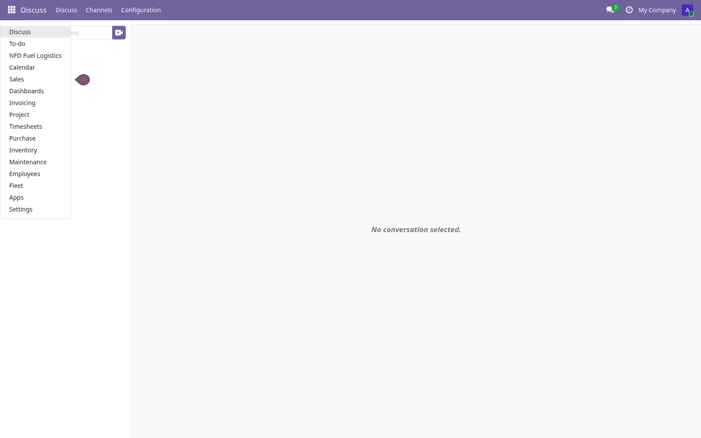

---

### Step 2: Customer Fuel Orders
**Stage:** `STAGE 1: ORDER & PREPARATION`  
**Excel Reference:** *Sales App > Fuel delivery contract*

- **Navigation:** `Sales > Orders > Orders`
- **Buttons to Click:**
  1. Click App Switcher `[ ☷ ]` &gt; Click `[ Sales ]` &gt; Click `[ Orders ]` &gt; `[ Orders ]`.
  2. Select order `[ S00003 ]` (B2Gold Otjikoto) or click `[ New ]` to book a delivery.
- **What Happens:**
  - Shows the confirmed customer order: 42,000 Litres of Diesel to B2Gold Otjikoto Mine (NAD 1,091,160.00). The delivery is now ready to dispatch.

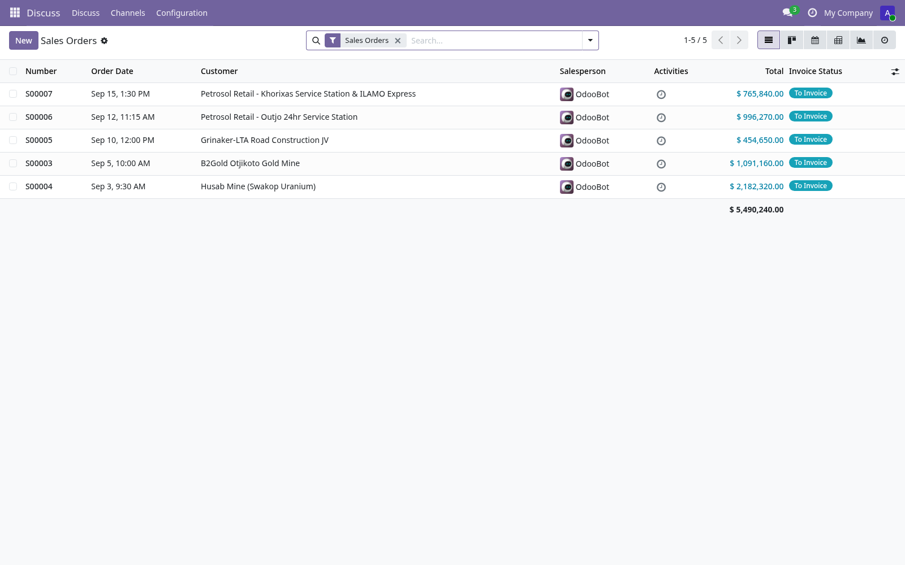

---

### Step 3: Drivers & Licences
**Stage:** `STAGE 1: ORDER & PREPARATION`  
**Excel Reference:** `Copy of Vehicle Info New.xlsx` &gt; `DRIVER INFORMATION` *(A3:K45)*

- **Navigation:** `NFD Fuel Logistics > Drivers > Drivers & Licences`
- **Buttons to Click:**
  1. Click `[ Drivers ]` &gt; Click `[ Drivers & Licences ]`.
  2. Select driver `[ Mike Mburu ]` or trainee `[ Tobias Leopold ]`.
- **What Happens:**
  - Confirms the assigned driver has a valid heavy vehicle licence (Code CE), dangerous goods permit, and medical clearance. The system flags if any licence is expired.

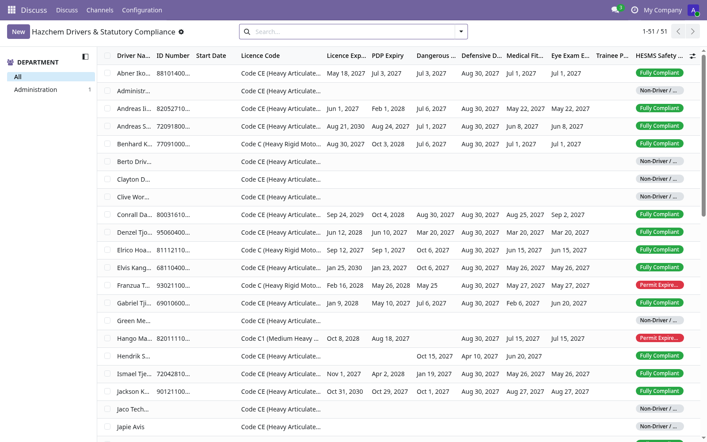

---

### Step 4: Permit & Inspection Calendar
**Stage:** `STAGE 1: ORDER & PREPARATION`  
**Excel Reference:** *Calendar App > Renewal schedule*

- **Navigation:** `Calendar > Switch to List View [ ☰ ]`
- **Buttons to Click:**
  1. Click App Switcher `[ ☷ ]` &gt; Click `[ Calendar ]`.
  2. Click the `[ ☰ List View ]` button in the top-right corner.
- **What Happens:**
  - Shows upcoming expiry dates for roadworthy tests (NaTIS), pump calibrations, and driver permits so trucks are not stopped on the road.

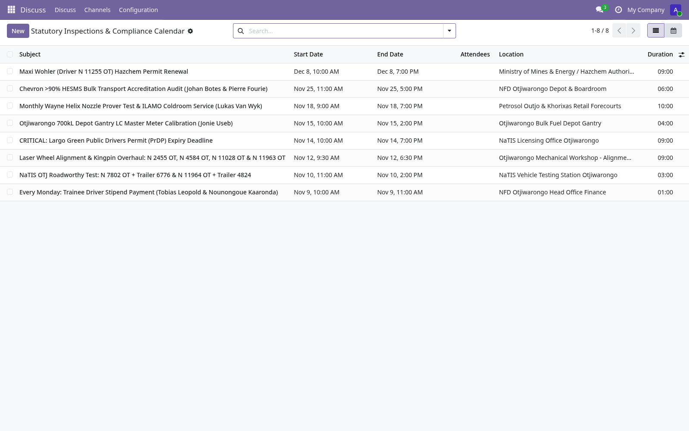

---

### Step 5: Truck & Trailer Details (Truck N 7802 OT)
**Stage:** `STAGE 1: ORDER & PREPARATION`  
**Excel Reference:** `Copy of Vehicle Info New.xlsx` &gt; `FLEET SERVICE` & `DRIVER ALLOCATION`

- **Navigation:** `Fleet > Vehicles > Select N 7802 OT`
- **Buttons to Click:**
  1. Click App Switcher `[ ☷ ]` &gt; Click `[ Fleet ]` &gt; `[ Vehicles ]` &gt; Open `[ N 7802 OT ]`.
  2. Click smart buttons: `[ Drivers ]`, `[ Fuel Receipts ]`, `[ Dispatches ]`.
  3. Switch between tabs to see fuel policy, workshop service dates, and wheel alignment.
- **What Happens:**
  - Shows everything about the truck: attached tanker trailer 6776, assigned driver, current odometer reading, target fuel consumption (2.00 KM/L), and branding.

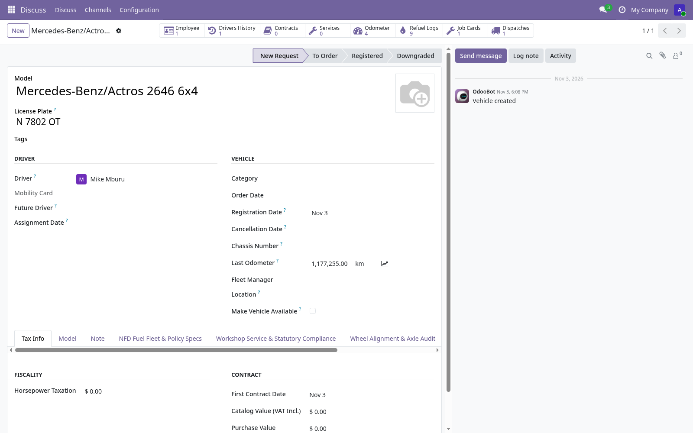

---

### Step 6: Fleet Availability
**Stage:** `STAGE 1: ORDER & PREPARATION`  
**Excel Reference:** `Copy of Vehicle Info New.xlsx` &gt; `AVAILABILITY` *(A2:G35)*

- **Navigation:** `NFD Fuel Logistics > Dashboards > Fleet Availability`
- **Buttons to Click:**
  1. Click `[ Dashboards ]` &gt; Click `[ Fleet Availability ]`.
  2. Use `[ Group By ]` to group by truck group.
- **What Happens:**
  - Shows which trucks are active, in the workshop, or on standby. Ensures backup trucks are available before sending out new deliveries.

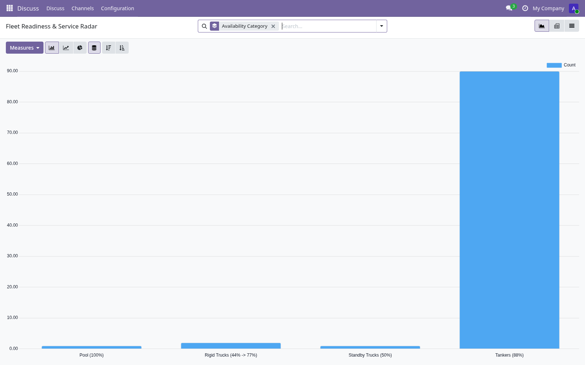

---

### Step 7: Fuel Dispatches & Deliveries
**Stage:** `STAGE 2: LOADING & ON THE ROAD`  
**Excel Reference:** *Tracks bulk fuel loaded vs delivered*

- **Navigation:** `NFD Fuel Logistics > Fuel Operations > Fuel Dispatches & Deliveries`
- **Buttons to Click:**
  1. Click `[ Fuel Operations ]` &gt; Click `[ Fuel Dispatches & Deliveries ]`.
  2. Select dispatch `[ DISP/2026/0102 ]`.
- **What Happens:**
  - Records fuel loaded at Otjiwarongo depot (42,000 L) into tanker 6776, and fuel delivered at B2Gold (41,790 L). If loss exceeds 0.25%, an alert flags a potential leak or theft.

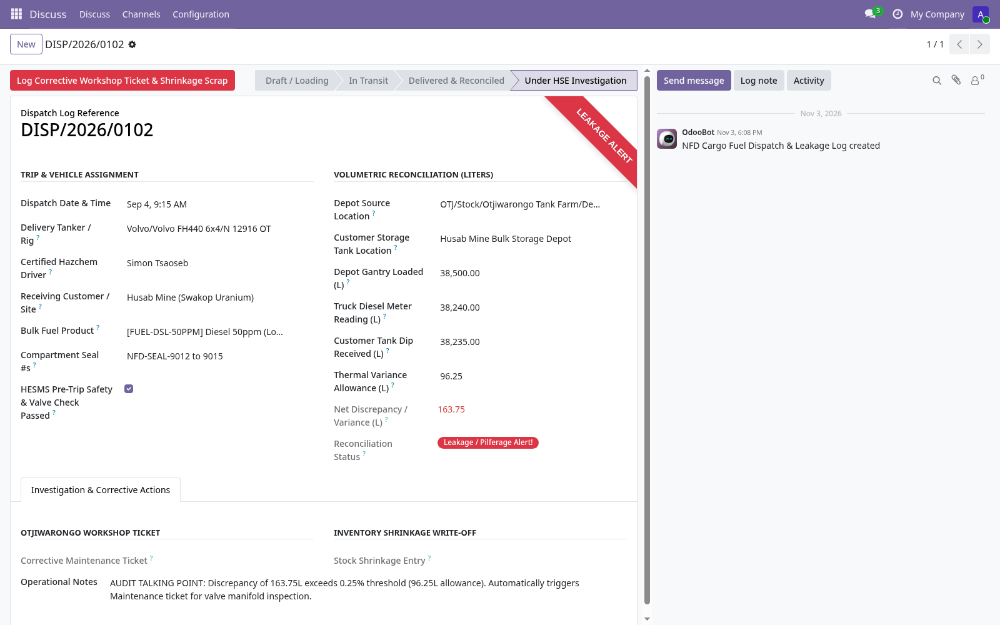

---

### Step 8: Delivery Tasks
**Stage:** `STAGE 2: LOADING & ON THE ROAD`  
**Excel Reference:** `Copy of Vehicle Info New.xlsx` &gt; `PROJECTS` *(A3:I35)*

- **Navigation:** `Project > Tasks > All Tasks`
- **Buttons to Click:**
  1. Click App Switcher `[ ☷ ]` &gt; Click `[ Project ]` &gt; Click `[ Tasks ]` &gt; `[ All Tasks ]`.
  2. Click any active delivery task.
- **What Happens:**
  - Tracks trips as they move along transport routes (e.g. Walvis Bay to Otjiwarongo, or Otjiwarongo to B2Gold). Controllers see trip status and driver hours.

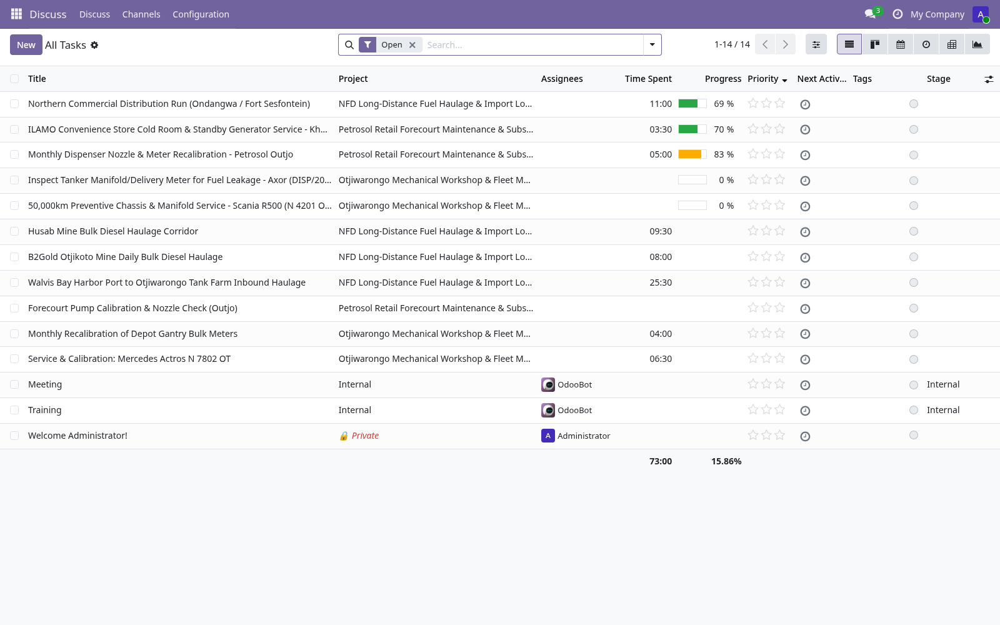

---

### Step 9: Emergency Repair Contacts
**Stage:** `STAGE 2: LOADING & ON THE ROAD`  
**Excel Reference:** `Copy of Vehicle Info New.xlsx` &gt; `BREAKDOWN` *(A3:E20)*

- **Navigation:** `NFD Fuel Logistics > Workshop > Emergency Repair Contacts`
- **Buttons to Click:**
  1. Click `[ Workshop ]` &gt; Click `[ Emergency Repair Contacts ]`.
  2. Filter by town or route (e.g. B1 North).
- **What Happens:**
  - If a truck breaks down or gets a flat tyre on the road, dispatchers quickly find the nearest approved mechanic, towing service, or tyre shop along that highway.

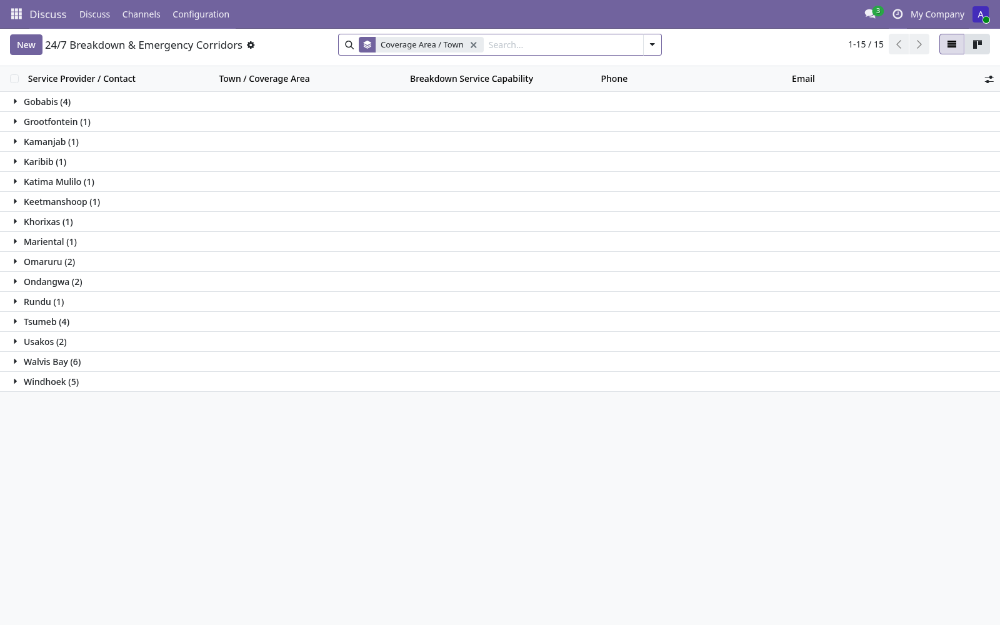

---

### Step 10: Driver Fuel Receipts
**Stage:** `STAGE 3: FUEL CONSUMPTION & AUDIT`  
**Excel Reference:** `Copy of Fuel Consumption 09 2026.xlsx` &gt; *Vehicle Sheets (Rows 10:24)*

- **Navigation:** `NFD Fuel Logistics > Fuel Operations > Driver Fuel Receipts`
- **Buttons to Click:**
  1. Click `[ Fuel Operations ]` &gt; Click `[ Driver Fuel Receipts ]`.
  2. Click `[ New ]` to enter a receipt, then click `[ Save ]`.
- **What Happens:**
  - Enters the refuel slip: Truck, Driver, Odometer Start/End, Litres pumped, and Station. The system calculates distance traveled, KM/L, and updates the truck odometer.

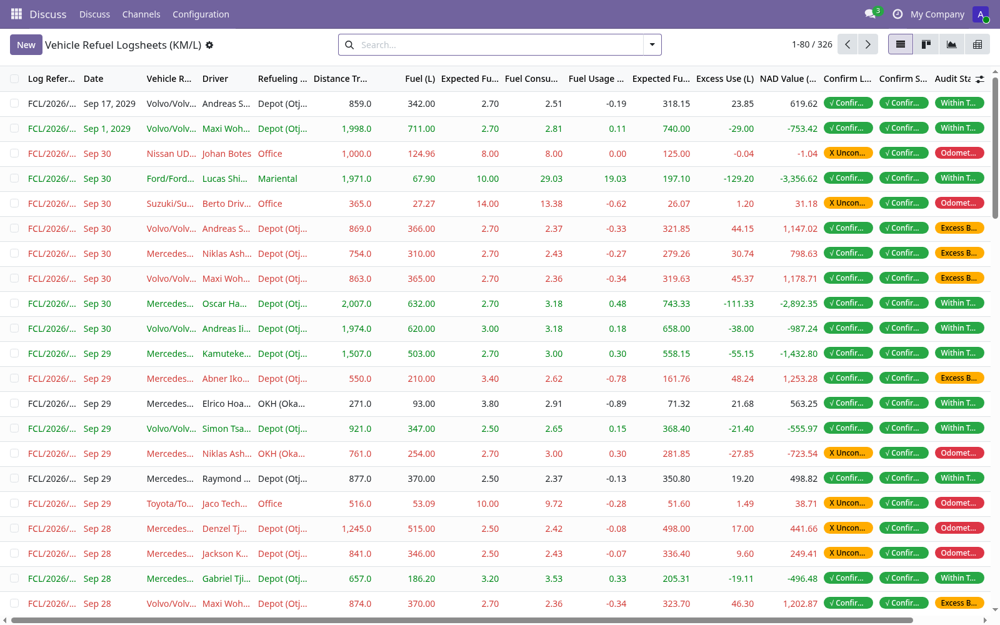

---

### Step 11: Fuel Review (Cards)
**Stage:** `STAGE 3: FUEL CONSUMPTION & AUDIT`  
**Excel Reference:** `Copy of Fuel Consumption 09 2026.xlsx` &gt; *Summary Sheet & Tabs*

- **Navigation:** `NFD Fuel Logistics > Dashboards > Fuel Review (Cards)`
- **Buttons to Click:**
  1. Click `[ Dashboards ]` &gt; Click `[ Fuel Review (Cards) ]`.
  2. Click any card to inspect trip audit details.
- **What Happens:**
  - Sorts all 326 refuel slips into 3 clear groups: **Excess Burn (83 trips)**, **Within Target (177 trips)**, and **Needs Check (66 trips with clerical errors or missing slips)**.

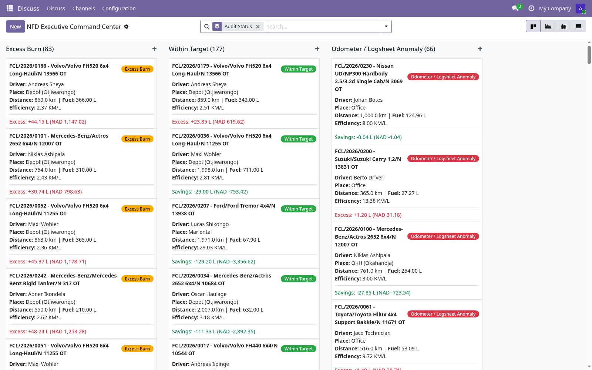

---

### Step 12: Monthly Fuel Summary
**Stage:** `STAGE 3: FUEL CONSUMPTION & AUDIT`  
**Excel Reference:** `Copy of Fuel Consumption 09 2026.xlsx` &gt; `Summary` *(B4:I50)*

- **Navigation:** `NFD Fuel Logistics > Fuel Operations > Monthly Fuel Summary`
- **Buttons to Click:**
  1. Click `[ Fuel Operations ]` &gt; Click `[ Monthly Fuel Summary ]`.
  2. Click any vehicle row to open the complete monthly breakdown.
- **What Happens:**
  - Summarizes all 41 vehicles for the month: 285,640 km driven, 100,269.5 L consumed, and +2,871.4 L excess fuel. Exactly matches the master monthly Excel summary sheet.

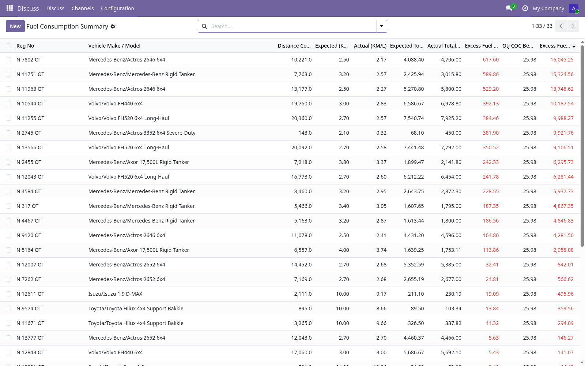

---

### Step 13: Fuel Costs & Savings
**Stage:** `STAGE 3: FUEL CONSUMPTION & AUDIT`  
**Excel Reference:** `Copy of Fuel Consumption 09 2026.xlsx` &gt; `Summary` *(C3:E3, G4:I45)*

- **Navigation:** `NFD Fuel Logistics > Dashboards > Fuel Costs & Savings`
- **Buttons to Click:**
  1. Click `[ Dashboards ]` &gt; Click `[ Fuel Costs & Savings ]`.
  2. Switch between `[ Bar Chart ]` and `[ Pivot ]` view in the top-right.
- **What Happens:**
  - Converts fuel variance into Namibia Dollars using the fuel price (**NAD 25.98 / L**). Shows how much money was lost on high-burn trucks (+NAD 122,701) and saved on efficient trucks (-NAD 48,102).

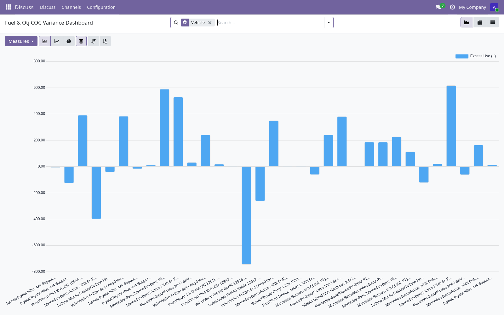

---

### Step 14: Fuel by Station
**Stage:** `STAGE 3: FUEL CONSUMPTION & AUDIT`  
**Excel Reference:** `Copy of Fuel Consumption 09 2026.xlsx` &gt; *Vehicle Sheets (Column F: Place)*

- **Navigation:** `NFD Fuel Logistics > Dashboards > Fuel by Station`
- **Buttons to Click:**
  1. Click `[ Dashboards ]` &gt; Click `[ Fuel by Station ]`.
  2. Click `[ Measures ]` to view Litres or Number of Refuels.
- **What Happens:**
  - Shows where the fleet refuels most often (Otjiwarongo Depot, Walvis Bay, Agra Vivo, etc.). Helps management negotiate bulk discounts at the busiest fuel stops.

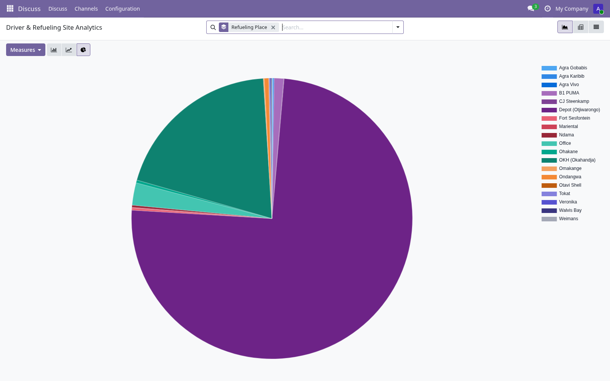

---

### Step 15: Vehicle Service Due Dates
**Stage:** `STAGE 4: WORKSHOP & MAINTENANCE`  
**Excel Reference:** `Copy of Vehicle Info New.xlsx` &gt; `FLEET SERVICE` *(A5:L45)*

- **Navigation:** `NFD Fuel Logistics > Fleet & Assets > Vehicle Service Due Dates`
- **Buttons to Click:**
  1. Click `[ Fleet & Assets ]` &gt; Click `[ Vehicle Service Due Dates ]`.
  2. Click filter `[ Service Due ]` to view overdue vehicles.
- **What Happens:**
  - As drivers log km on refuel slips, the system counts down to the next service (15,000, 30,000, or 50,000 km). When km remaining hits 0, it flags the truck as **Service Due**.

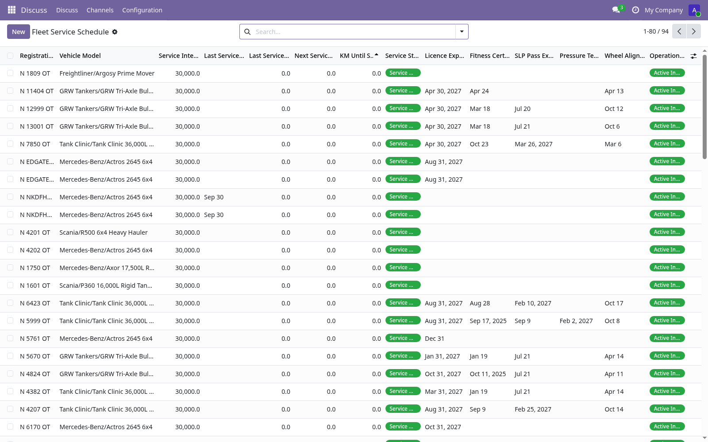

---

### Step 16: Wheel Alignment Check
**Stage:** `STAGE 4: WORKSHOP & MAINTENANCE`  
**Excel Reference:** `Copy of Vehicle Info New.xlsx` &gt; `Wheel Alignment Worksheet`

- **Navigation:** `NFD Fuel Logistics > Fleet & Assets > Wheel Alignment Check`
- **Buttons to Click:**
  1. Click `[ Fleet & Assets ]` &gt; Click `[ Wheel Alignment Check ]`.
  2. Select red-flagged vehicle `[ N 4584 OT ]`.
- **What Happens:**
  - Tracks laser wheel alignment measurements. Flags trucks with bad alignment (like N 4584 OT), which scrubs tyres and burns up to 3 times more fuel than normal.

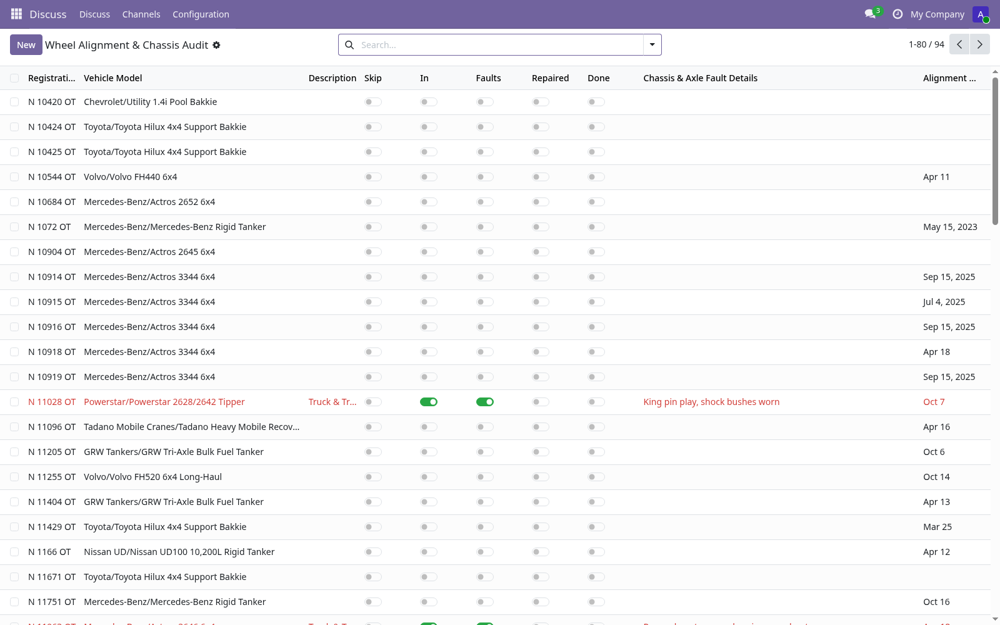

---

### Step 17: Workshop Job Cards
**Stage:** `STAGE 4: WORKSHOP & MAINTENANCE`  
**Excel Reference:** `Copy of Vehicle Info New.xlsx` &gt; `PROJECTS` *(A3:I35)*

- **Navigation:** `NFD Fuel Logistics > Workshop > Workshop Job Cards`
- **Buttons to Click:**
  1. Click `[ Workshop ]` &gt; Click `[ Workshop Job Cards ]`.
  2. Select job card `[ JC-1009 ]` or click `[ New ]`.
- **What Happens:**
  - Creates a repair order for the workshop. Links the truck, trailer, current odometer, and assigns mechanics (e.g. Japie or Clive) to fix the issue or do a service.

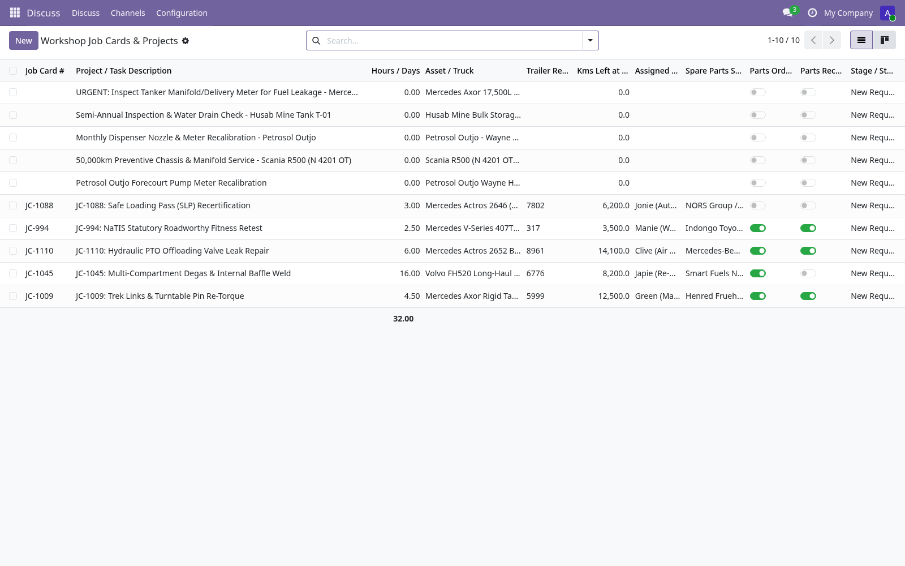

---

### Step 18: Mechanic Hours & Progress
**Stage:** `STAGE 4: WORKSHOP & MAINTENANCE`  
**Excel Reference:** `Copy of Vehicle Info New.xlsx` &gt; `PROJECTS` *(Mechanic Allocation)*

- **Navigation:** `NFD Fuel Logistics > Dashboards > Mechanic Hours & Progress`
- **Buttons to Click:**
  1. Click `[ Dashboards ]` &gt; Click `[ Mechanic Hours & Progress ]`.
  2. Click on any mechanic column to drill down into assigned job cards.
- **What Happens:**
  - Shows hours worked by each mechanic and the progress on each job card. Helps workshop managers see who is busy and keep repairs on schedule.

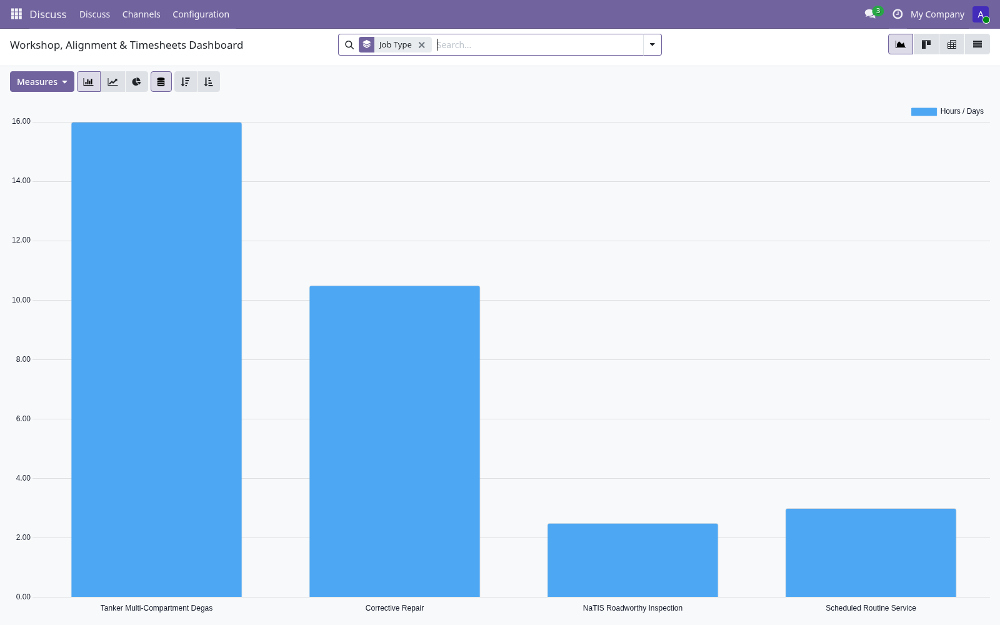

---

### Step 19: Spare Parts in Depot
**Stage:** `STAGE 4: WORKSHOP & MAINTENANCE`  
**Excel Reference:** *Inventory App > Spare parts catalog*

- **Navigation:** `Inventory > Products > Products`
- **Buttons to Click:**
  1. Click App Switcher `[ ☷ ]` &gt; Click `[ Inventory ]` &gt; Click `[ Products ]` &gt; `[ Products ]`.
  2. Select any part card (e.g. Scania filter kits, Mercedes fuel filters, Pirelli tyres).
- **What Happens:**
  - Shows spare parts available in the Otjiwarongo workshop: filters, tyres, and engine oil. Stock counts decrease automatically whenever parts are used on a job card.

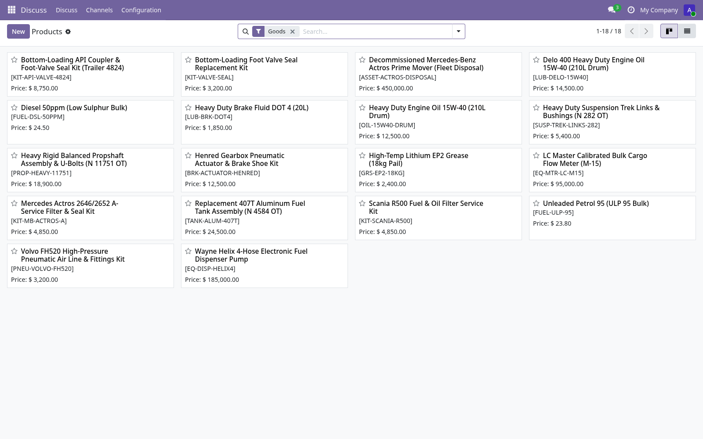

---

### Step 20: Orders to Parts Suppliers
**Stage:** `STAGE 4: WORKSHOP & MAINTENANCE`  
**Excel Reference:** *Purchase App > Parts purchasing*

- **Navigation:** `Purchase > Purchase Orders`
- **Buttons to Click:**
  1. Click App Switcher `[ ☷ ]` &gt; Click `[ Purchase ]` &gt; Click `[ Purchase Orders ]`.
  2. Select order `[ PO00004 ]` (Commercial Tyres Namibia).
- **What Happens:**
  - Creates purchase orders to buy replacement parts from suppliers. Matches the purchase order against the delivery receipt and supplier invoice before payment is approved.

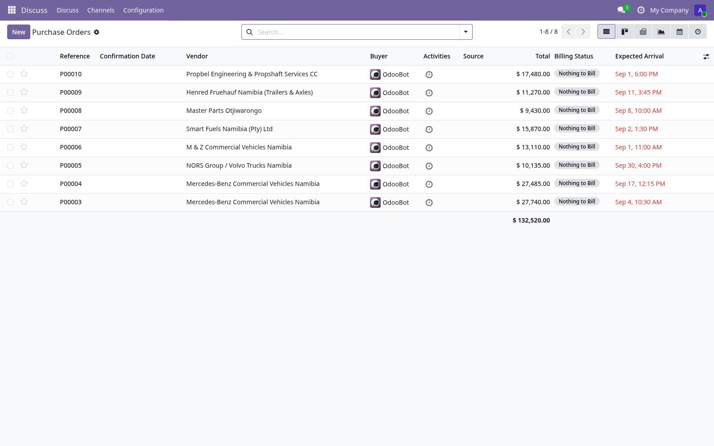

---

### Step 21: Customer Invoices
**Stage:** `STAGE 5: INVOICING & PAYMENT`  
**Excel Reference:** *Invoicing App > Customer Billing*

- **Navigation:** `Invoicing > Customers > Invoices`
- **Buttons to Click:**
  1. Click App Switcher `[ ☷ ]` &gt; Click `[ Invoicing ]` &gt; Click `[ Customers ]` &gt; `[ Invoices ]`.
  2. Select invoice `[ INV/2026/0003 ]` for B2Gold Otjikoto.
- **What Happens:**
  - Creates the final customer invoice after fuel is delivered. Calculates the delivery rate, adds fuel surcharges, and records revenue into accounting to complete the order.

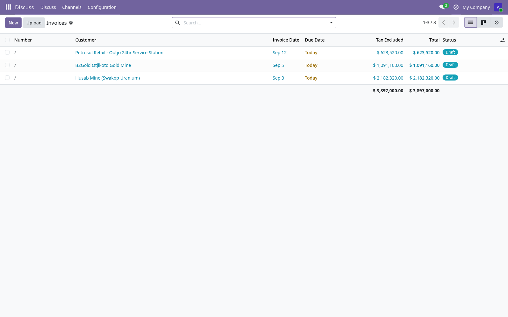

---

## Appendix: Live Presentation Script (Clean Vehicle N 10420 OT)

To demonstrate Odoo's automated fleet intelligence live to client executives, execute the following 3-step live demo sequence using clean utility bakkie **`N 10420 OT`** (Chevrolet Utility 1.4i Support Bakkie).

### Step 1: Verify Initial Clean State in Fleet
1. Click **Fleet** &gt; **Vehicles** &gt; Open **`N 10420 OT`**.
2. Point out to the audience:
   - Current Odometer: `0.0 km`
   - Refuel Logs smart button: `Refuel Logs (0)`
   - Service Status badge: `OK` (`badge-success`)
   - Job Cards smart button: `Job Cards (0)`

### Step 2: Enter Milestone-Crossing Refuel Slip
1. Click **NFD Fuel Logistics** &gt; **Fuel Operations** &gt; **Driver Fuel Receipts** &gt; Click `[ New ]`.
2. Fill in:
   - Vehicle: `N 10420 OT`
   - Driver: `Jaco Technician`
   - Start Odometer: `150,000.0 km`
   - End Odometer: `152,000.0 km` *(Distance: 2,000.0 km)*
   - Fuel Liters: `220.0 L` *(Efficiency: 9.09 KM/L vs 10.00 benchmark)*
   - Place: `Depot (Otjiwarongo)`
3. Click `[ Save ]`.

### Step 3: Observe the Real-Time Ripple Effect
1. Return to **Fleet** &gt; **Vehicles** &gt; Open **`N 10420 OT`**.
2. Point out the automated system updates:
   - **Odometer Auto-Advance:** Vehicle odometer jumped from `0.0 km` to `152,000.0 km`.
   - **Dynamic Service Status:** Crossing the 150,000 km threshold flipped status from `OK` to **`Service Due`**.
   - **Automated Job Card Creation:** Automation 3 detected the status and generated maintenance task **`JC-AUTO-49`** assigned directly to lead mechanic **Clive**! Smart button now displays **`Job Cards (1)`**.
