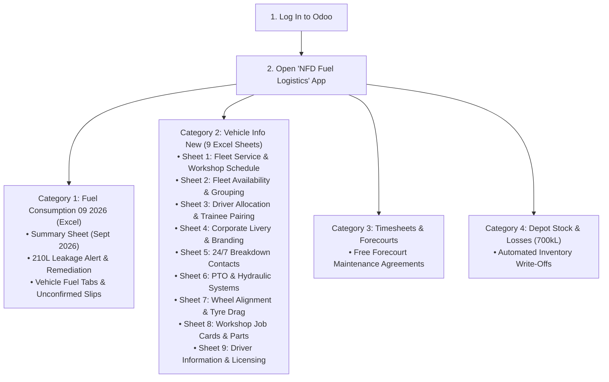

# Standard Operating Procedure (SOP) & End-to-End Navigation Guide
## Client: Northern Fuel Distributors CC (NFD) & Petrosol Petroleum Solutions CC
- **Head Office & Main Depot:** Otjiwarongo, Namibia
- **Primary Stakeholders:** Johan Botes (Managing Member / GM / Operations / Workshop) & Pierre Fourie (Financial Manager)
- **Target Audience:** Non-technical operational staff, workshop managers, depot clerks, executive leadership, and demo facilitators
- **System Platform:** Odoo 19 / Odoo 20 (`nfd_petrosol_demo`)
- **Operational Scale:** Bulk Fuel Distribution (>4,000,000 L/Month), 700kL Storage Depot, In-House Otjiwarongo Engineering Workshop, Trans-Namibian Corridor Fleet

---

## 1. Executive Overview & System Purpose

Northern Fuel Distributors CC (NFD) and their retail fuel brand Petrosol Petroleum Solutions CC manage one of Namibia's most critical fuel distribution operations. From their primary 700,000-liter bulk storage depot and mechanical workshop in Otjiwarongo, NFD moves over 4 million liters of diesel (50ppm) and unleaded petrol (ULP 95) each month to tier-1 mines (Husab Uranium, B2Gold Otjikoto), road infrastructure projects (Grinaker-LTA, Raubex), commercial agriculture, and Petrosol retail forecourts.

This guide provides simple, step-by-step instructions for navigating every screen, menu, and button in Odoo. Every process maps directly back to the exact sheets and cells in NFD's master Excel workbooks:
1. **`Copy of Fuel Consumption 09 2026.xlsx`** (44 sheets: `Summary`, `Template`, and 42 vehicle refuel tabs)
2. **`Copy of Vehicle Info New.xlsx`** (9 sheets: `FLEET SERVICE`, `PROJECTS`, `AVAILABLITY`, `DRIVER ALLOCATION`, `DRIVER INFORMATION`, `BREAKDOWN CONTACTS`, `BRANDING`, `PTO`, `Wheel Allignment Worksheet`)

---

## 2. Master Excel-to-Odoo Direct Reference Matrix

Use this quick-reference table to connect any Excel sheet and cell range directly to its live Odoo screen:

| Excel Workbook & Sheet | Exact Excel Cell Range | Live Odoo Menu Navigation | Odoo Screen Purpose & Key Calculations |
|---|---|---|---|
| **Fuel Consumption 09 2026** • `Summary` | `Summary!C3:E3` `Summary!B4:I49` | **NFD Fuel Logistics > Fuel Consumption 09 2026 (Excel) > Summary Sheet (Sept 2026)** | Fleet-wide fuel audit showing Distance (KM), Benchmark Expected KM/L, Actual KM/L, Actual Liters, Excess Liters, and Excess NAD Value @ benchmark price **NAD 25.98 / L** (`Summary!C3:E3`). |
| **Fuel Consumption 09 2026** • `[Vehicle Reg]` (42 tabs) | `[Reg]!B10:N40` `[Reg]!J6` (Warning) | **NFD Fuel Logistics > Fuel Consumption 09 2026 (Excel) > Vehicle Fuel Tabs (43 Units)** | Individual refuel slips: Start/End Odometer, Distance, Liters, KM/L, Driver, Facility, and Logsheet confirmation (`X`). Eliminates the manual `J6` duplicate reading requirement. |
| **Vehicle Info New** • `FLEET SERVICE` | `FLEET SERVICE!A1:AB1` | **NFD Fuel Logistics > Vehicle Info New (9 Excel Sheets) > Sheet 1: Fleet Service & Workshop Schedule** | Asset register tracking service intervals, last service odometer, next service milestone, km remaining, NaTIS license/fitness expiry dates, and Safe Loading Pass (SLP). |
| **Vehicle Info New** • `AVAILABLITY` | `AVAILABILITY!A1:E1` | **NFD Fuel Logistics > Vehicle Info New (9 Excel Sheets) > Sheet 2: Fleet Availability & Grouping** | Tracks operational readiness across Rigids (77% target), Tankers (88% target), Standby (50%), Maintenance (100%), Installations (60%), and Decommissioned For Sale units. |
| **Vehicle Info New** • `DRIVER ALLOCATION` | `DRIVER ALLOCATION!A1:H1` | **NFD Fuel Logistics > Vehicle Info New (9 Excel Sheets) > Sheet 3: Driver & Trailer Allocation** | Roster pairing prime movers with permanent drivers, trainee co-drivers (Tobias Leopold, Nounongoue Kaaronda), coupled B-double trailers, and standby notes. |
| **Vehicle Info New** • `BRANDING` | `BRANDING!A1:H1` | **NFD Fuel Logistics > Vehicle Info New (9 Excel Sheets) > Sheet 4: Corporate Livery & Branding** | Audit tracking vehicles and trailers requiring corporate decals and vinyl installation at GT Vinyl, along with remote location notes (`x_branding_notes`). |
| **Vehicle Info New** • `BREAKDOWN CONTACTS` | `BREAKDOWN CONTACTS!A3:F3` | **NFD Fuel Logistics > Vehicle Info New (9 Excel Sheets) > Sheet 5: 24/7 Breakdown Contacts & Corridors** | 33 vetted roadside repair, towing, auto-electrical, and tyre vendors across 14 Namibian transport corridors for instant 24/7 emergency dispatch. |
| **Vehicle Info New** • `PTO` | `PTO!A1:F1` | **NFD Fuel Logistics > Vehicle Info New (9 Excel Sheets) > Sheet 6: PTO & Hydraulic Systems** | Audit of auxiliary engine PTOs (`x_pto_engine`), transmission hydraulic PTOs (`x_hydraulic_pto`), and pump mounting positions behind the cab or on tanker chassis. |
| **Vehicle Info New** • `Wheel Allignment Worksheet` | `Wheel Allignment Worksheet!A1:L1` `Rows 33–36` (Faults) | **NFD Fuel Logistics > Vehicle Info New (9 Excel Sheets) > Sheet 7: Wheel Alignment Worksheet** | Laser axle, kingpin, and suspension audit. Red row highlighting flags unresolved faults causing severe tyre drag and excess fuel consumption. |
| **Vehicle Info New** • `PROJECTS` | `PROJECTS!A3:Y3` | **NFD Fuel Logistics > Vehicle Info New (9 Excel Sheets) > Sheet 8: Workshop Job Cards & Projects** | Otjiwarongo workshop job cards: Job Card #, Hours/Days (`x_hours_days`), Asset, Trailer Reg (`x_trailer_reg`), Kms Left at Check-In, Mechanic, and Parts Status. |
| **Vehicle Info New** • `DRIVER INFORMATION` | `DRIVER INFORMATION!A1:P1` | **NFD Fuel Logistics > Vehicle Info New (9 Excel Sheets) > Sheet 9: Driver Information & Licensing** | 34-driver statutory compliance register: National ID, Start Date, Licence Code (CE, C), PrDP, Hazchem, Defensive Driving, Medical, and Trainee Payment cycle. |

---

## 3. Step-by-Step Click-by-Click Demonstration Journey

---

### STAGE 1: Log In & Home Screen Overview

1. Open your web browser (Chrome, Firefox, or Safari).
2. Enter the URL:
   - **Local Docker Demo:** `http://localhost:8069`
   - **Cloud SaaS Demo:** `https://edu-<subdomain>.odoo.com`
3. Enter your login details:
   - **Email:** `admin`
   - **Password:** `admin`
4. Click the purple **Log in** button.
5. **What you see on screen:** 
   You are on the main **App Drawer** home screen. You will see icons for:
   - **NFD Fuel Logistics** (Our primary custom operations hub)
   - **Fleet** (Standard vehicle master)
   - **Maintenance** (Workshop management)
   - **Employees** (HR and drivers)
   - **Inventory** (Depot bulk tanks)
   - **Timesheets** (Technician hours)
6. Click directly on the **NFD Fuel Logistics** app icon.

---

### STAGE 2: Category 1 — Fuel Consumption 09 2026 (Pierre Fourie & Accounting Focus)

In this stage, you demonstrate how Odoo digitizes the 44-tab fuel consumption workbook, captures benchmark savings, and eliminates Excel formula errors.

#### Step 2.1: Open the September 2026 Fuel Summary Sheet
1. Look at the top navigation bar. Click on:
   👉 **Fuel Consumption 09 2026 (Excel)**
2. In the dropdown menu, click:
   👉 **Summary Sheet (Sept 2026)**
3. **What you see on screen:**
   - A clean, comprehensive list showing all fleet vehicles that ran in September 2026.
   - This screen directly replicates **`Summary!B4:I49`**.
   - Notice the columns:
     - **Reg No** (`Summary!B4`)
     - **Vehicle Make / Model** (`Summary!C4`)
     - **Distance Covered (KM)** (`Summary!D4`)
     - **Expected (KM/L)** (`Summary!E4`)
     - **Actual (KM/L)** (`Summary!F4`)
     - **Expected Total Fuel (L)** (`Summary!G4`)
     - **Actual Total Fuel (L)** (`Summary!H4`)
     - **Excess Use (L)** (`Summary!I4`)
     - **Current Otj COC Price** (`Summary!C3:E3` = **NAD 25.98 / L**)
     - **Excess NAD Value** (Total financial penalty or savings)
   - Look at the bottom right corner of the table: the **Total Excess Value (NAD)** is automatically summed without any broken `=#REF!` formula errors!

#### Step 2.2: Examine Top Over-Consumers (Excess Diesel Burn)
1. Click on the column header **Excess NAD Value** to sort the table from highest to lowest.
2. **What to point out to Pierre Fourie:**
   - **Rank 1: Mercedes-Benz Actros 2646 (`N 7802 OT`)**
     - Traveled `10,221 km`. Actual fuel burned: `4,706.00 L` (2.17 KM/L vs expected 2.50 KM/L).
     - Excess fuel burned: **+617.60 Liters**.
     - Cost to NFD: **+NAD 16,045.25** in excess fuel expense.
   - **Rank 2: Mercedes-Benz Axor Rigid Tanker (`N 11751 OT`)**
     - Traveled `7,763 km`. Actual consumption: `2.57 KM/L` vs expected 3.20 KM/L.
     - Excess fuel burned: **+589.86 Liters**.
     - Cost to NFD: **+NAD 15,324.63**.
   - **Rank 3: Mercedes-Benz Actros 2646 (`N 11963 OT`)**
     - Traveled `10,582 km`. Actual consumption: `2.29 KM/L` vs expected 2.40 KM/L.
     - Excess fuel burned: **+529.20 Liters**.
     - Cost to NFD: **+NAD 13,748.62**. *(Note: This unit has an un-squared rear axle on Sheet 7 that causes severe tyre drag!)*
   - **The Yard Shunting Anomaly (`N 2745 OT`):**
     - Actros 3352 drove only `143 km` but used `450.00 L` (0.32 KM/L), generating a **+NAD 9,921.89** variance. In Excel, the clerk wrote `"??????"`. In Odoo, management sees this was stationary engine PTO idling in the yard.

#### Step 2.3: Celebrate the Star Fuel Savers
1. Click the column header **Excess NAD Value** again to invert the sort order (lowest first, showing negative values).
2. **What to point out:**
   - **Top Saver: Volvo FH440 with PUP Trailer (`N 12916 OT` — Driver Simon)**
     - Traveled `14,540 km` at an outstanding `2.87 KM/L` against the 2.50 KM/L target.
     - **Fuel Saved: -745.90 Liters = -NAD 19,378.48 straight into NFD bottom-line profit!**
   - **Second Saver: Mercedes Actros 2652 (`N 10684 OT`)**
     - Traveled `20,012 km` at `2.85 KM/L` vs 2.70 KM/L target.
     - **Fuel Saved: -399.25 Liters = -NAD 10,372.56 saved.**

#### Step 2.4: Discover the Excel Formula Errors Caught by Odoo
1. In the top search bar, type `13938` and press Enter.
2. Click on the row for `N 13938 OT` (Ford Tremor 3.5 V6).
3. **The Story for Pierre Fourie:**
   - In Excel, on cell `Summary!D30`, the clerk copied the formula from row 29 (`='N 12843 OT'!$G$6`), linking the pickup to a heavy Volvo truck's odometer. On the vehicle's tab, the end odometer was left blank, resulting in negative distance `-28,814 km`.
   - Excel calculated a false penalty of **+3,324.28 Liters = NAD 86,364.79**!
   - In Odoo, trip distances are validated per transaction. The true distance was `5,050 km` at `10.13 KM/L`, actually saving 6.6 liters. Odoo saves NFD from a fictitious **NAD 86,364** management distortion.
4. **The Missing Vehicle Discovery (`N 12611 OT` — Isuzu D-Max):**
   - Click the search bar, remove `13938`, type `12611`, and press Enter.
   - In Excel, this Isuzu D-Max (2,111 km, 230.19 L) was completely missing from `Summary!B5:I49`. In Odoo, every asset with fuel transactions automatically appears on the summary.

#### Step 2.5: Audit Unconfirmed Driver Fuel Slips (`Confirm = 'X'`)
1. Click the top menu: **Fuel Consumption 09 2026 (Excel) > Vehicle Fuel Tabs (43 Units)**.
2. This list displays all individual refuel transactions matching the 42 vehicle tabs (`[Reg]!B10:N40`).
3. Click the **Filters** dropdown button below the search bar, then click:
   👉 **Unconfirmed Logsheets (X)**
4. **What you see:**
   - Exactly the **29 trips** where fuel was dispensed at depot pumps before the driver submitted a signed logsheet (where the clerk marked `X` in column L).
   - Accounts clerks can audit and verify these 29 slips one by one before month-end closing.
5. In record `FCL/2026/0004` (Vehicle `N 11751 OT`, Driver Benhardt), open the form:
   - Notice the actual driver remark from cell `N 11751 OT!N14` is preserved: *"Kilos nie reg nie ingeskryf nie sesfontein tot Otjiwarongo is 500km"*.

#### Step 2.6: Cargo Fuel Dispatch & The 210L Emergency Leakage Alert
1. Click the top menu: **Fuel Consumption 09 2026 (Excel) > Cargo Fuel Dispatch & Discrepancies**.
2. **What you see:** Bulk tanker deliveries loaded at the Otjiwarongo gantry and delivered to customer sites.
3. Click on row: **DISP/2026/0101** (Delivery to B2Gold Otjikoto Mine):
   - Loaded: `42,000.00 L`. Delivered: `41,895.00 L`.
   - **Thermal Allowance (0.25%):** `105.00 L` (Automatically calculated for ambient temperature changes).
   - **Net Discrepancy:** `0.00 L`. Top right ribbon: **RECONCILED**.
4. Click breadcrumb **Cargo Fuel Dispatch & Discrepancies** to return to the list.
5. Click on row: **DISP/2026/0102** (Delivery to Grinaker-LTA Road Project):
   - Top banner: Red alert badge **LEAKAGE ALERT!**.
   - Vehicle: `Mercedes Axor Rigid (N 1750 OT)`.
   - Loaded: `17,500.00 L`. Delivered: `17,246.25 L`. Allowance (0.25%): `43.75 L`.
   - **Net Discrepancy: 210.00 Liters!**
6. **Execute 1-Click Remediation:**
   - Click the red button in the top left:
     👉 **"Log Corrective Workshop Ticket & Shrinkage Scrap"**
   - **What happens instantly:**
     1. Automatically opens an emergency repair job card for the Otjiwarongo workshop: *"Emergency Inspection: Check Tanker Manifold & Flow Meter for Fuel Leakage"*.
     2. In the background, posts an inventory shrinkage scrap of **210 Liters** to keep Pierre's bulk fuel books 100% reconciled.

---

### STAGE 3: Category 2 — Vehicle Info New (Johan Botes & Workshop Focus)

In this stage, you demonstrate the 9 dedicated screens replicating each tab of `Copy of Vehicle Info New.xlsx`.

#### Step 3.1: Sheet 1 — Fleet Service & Workshop Schedule
1. Click the top menu: **Vehicle Info New (9 Excel Sheets) > Sheet 1: Fleet Service & Workshop Schedule**.
2. **What you see on screen:**
   - Direct replication of **`FLEET SERVICE!A1:AB1`**.
   - Columns: `Registration`, `Vehicle Model`, `Service Interval (KM)`, `Last Service Date`, `Last Service (KM)`, `Next Service (KM)`, `KM Until Service`, `Service Status`, `Licence Expiry`, `Fitness Cert Expiry`, `SLP Pass Expiry`, and `Wheel Alignment`.
3. Notice that the list is automatically ordered by `KM Until Service` ascending:
   - **Overdue Unit:** `Nissan UD100 (N 1166 OT)` shows red badge **Service Overdue** (`-821 km` past its 15,000 km service milestone).
   - **Due Soon Units:** Units within 5,000 km of service show amber badges **Service Due Soon**.

#### Step 3.2: Sheet 2 — Fleet Availability & Grouping
1. Click the top menu: **Vehicle Info New (9 Excel Sheets) > Sheet 2: Fleet Availability & Grouping**.
2. **What you see on screen:**
   - Direct replication of **`AVAILABILITY!A1:E1`**.
   - Grouped by NFD's availability targets:
     - **Rigid Trucks (44% -> 77% target):** 9 units.
     - **Tankers (88% target):** 8 units.
     - **Standby Trucks (50% target):** 2 units.
     - **Maintenance (100% target):** Active workshop vehicles.
     - **Installations (60% target):** Customer installation trucks.
     - **For Sale - Klaar (100%):** Decommissioned units `10914`, `10915`, `10916`, and `10919 Klaar - Maak reg vir verkoop`.

#### Step 3.3: Sheet 3 — Driver & Trailer Allocation
1. Click the top menu: **Vehicle Info New (9 Excel Sheets) > Sheet 3: Driver & Trailer Allocation**.
2. **What you see on screen:**
   - Direct replication of **`DRIVER ALLOCATION!A1:H1`**.
   - Columns: `Truck Reg No`, `Truck Model`, `Permanent Driver`, `Trainee Driver / Second Driver`, `Trailer / Link 1`, `Trailer / Link 2`, `Notes / Status`.
3. Highlight the trainee pairings for Johan:
   - **Row `N 4584 OT` (Mercedes Rigid):** Permanent Driver `Benhardt Kangandi` + Trainee Driver `Tobias Leopold` (matching *"BENHARDT - TOBIAS TRAINING"*).
   - **Row `N 10544 OT` (Volvo FH440):** Permanent Driver `Andreas Iipinge` + Trainee Driver `Nounongoue Kaaronda` (matching *"ANDREAS I - KARONDA TRAINING"*).
   - **Trailer Couplings:** Prime mover `N 11963 OT` is linked to Trailer 1 `N 7850 OT`.

#### Step 3.4: Sheet 4 — Corporate Livery & Branding
1. Click the top menu: **Vehicle Info New (9 Excel Sheets) > Sheet 4: Corporate Livery & Branding**.
2. **What you see on screen:**
   - Direct replication of **`BRANDING!A1:H1`**.
   - Status badges:
     - **Truck Needs Branding:** `N 4584 OT`, `N 5164 OT`, `N 6028 OT`, `N 10918 OT`.
     - **Trailer Needs Branding:** `N 7802 OT`, `N 8966 OT`, `N 9120 OT`, `N 11751 OT`, `N 11963 OT`, `N 12043 OT`, `N 12916 OT`, `N 12917 OT`, `N 13777 OT`.
   - Column **Branding / Location Notes** shows field comments like *"Katima - Terug 12/09/26"*.

#### Step 3.5: Sheet 5 — 24/7 Breakdown Contacts & Corridors
1. Click the top menu: **Vehicle Info New (9 Excel Sheets) > Sheet 5: 24/7 Breakdown Contacts & Corridors**.
2. **What you see on screen:**
   - Direct replication of **`BREAKDOWN CONTACTS!A3:F3`**.
   - 33 vetted roadside contractors categorized by capability: Heavy Mechanical, Auto Electrical, Towing, Commercial Tyres, or Full Breakdown Service.
3. In the search bar, type `Walvis Bay` or `Khorixas`:
   - If a driver has a blowout near Khorixas at midnight, dispatchers find **Jaques Joubert Breakdown (Khorixas)** and click to call immediately.

#### Step 3.6: Sheet 6 — PTO & Hydraulic Discharge Systems
1. Click the top menu: **Vehicle Info New (9 Excel Sheets) > Sheet 6: PTO & Hydraulic Systems**.
2. **What you see on screen:**
   - Direct replication of **`PTO!A1:F1`**.
   - Toggle columns for **PTO ENGINE** and **HYDRAULIC PTO**.
   - Mounting position column shows exact physical locations: *"Behind the Cab"*, *"On Cab next to COC Tank"*, *"PTO Engine on Tanker"*.

#### Step 3.7: Sheet 7 — Wheel Alignment Worksheet (The Tyre Drag Discovery)
1. Click the top menu: **Vehicle Info New (9 Excel Sheets) > Sheet 7: Wheel Alignment Worksheet**.
2. **What you see on screen:**
   - Direct replication of **`Wheel Allignment Worksheet!A1:L1`**.
   - Columns: `Registration`, `Model`, `Description`, `Skip`, `In`, `Faults`, `Repaired`, `Done`, `Chassis & Axle Fault Details`, and `Alignment Date`.
3. **Show Johan Botes the Red Highlighted Fault Units (`Rows 33–36`):**
   - **`N 2455 OT` (Mercedes Axor):** Highlighted in bold red. Faults: *"Spring bush wear out, broken studs, V-bone bushes worn, front diff loose"*. (Result: +242 L fuel penalty).
   - **`N 11028 OT` (Mercedes Actros):** Highlighted in bold red. Faults: *"King pin play, shock bushes worn"*.
   - **`N 4584 OT` (Mercedes Actros):** Highlighted in bold red. Faults: *"Steering axle king pin play, under pressure"*. (Result: +228 L fuel penalty).
   - **`N 11963 OT` (Mercedes Actros):** Highlighted in bold red. Faults: *"Rear axle not square, bearings need re-torque"*. (Result: +529 L fuel penalty).
4. **The Takeaway:** Alignment faults directly cause rolling resistance and tyre scrubbing, costing NFD tens of thousands of dollars in excess diesel. Odoo alerts Johan before trucks leave the depot.

#### Step 3.8: Sheet 8 — Workshop Job Cards & Projects
1. Click the top menu: **Vehicle Info New (9 Excel Sheets) > Sheet 8: Workshop Job Cards & Projects**.
2. **What you see on screen:**
   - Direct replication of **`PROJECTS!A3:Y3`**.
   - Columns: `Job Card #`, `Project / Task Description`, `Hours / Days`, `Asset / Truck`, `Trailer Reg No`, `Kms Left at Check-In`, `Assigned Mechanic`, `Spare Parts Supplier`, `Parts Ordered`, `Parts Received`, and `Stage`.
3. Review active job cards:
   - **`JC-1009`:** Turntable Pin Re-Torque on `N 12548 OT` (Trailer `5999`, 4.5 hours, Mechanic: Green, Supplier: Henred, Parts Received: Checked).
   - **`JC-1045`:** Multi-Compartment Degas on `N 12043 OT` (Trailer `6776`, 16.0 hours, Location: CWWA, Mechanic: Japie, Parts Ordered: Checked, Parts Received: Pending).
   - **`JC-1110`:** Hydraulic PTO Valve Leak Repair on `N 8966 OT` (Trailer `8961`, 6.0 hours, Mechanic: Clive).
   - **`JC-994`:** NaTIS Statutory Roadworthy on `N 317 OT` (Foreman: Manie).
   - **`JC-1088`:** Safe Loading Pass (SLP) Recertification on `N 7802 OT` (Vivo Depo, Mechanic: Jonie).

#### Step 3.9: Sheet 9 — Driver Information & Licensing (HESMS Safety Roster)
1. Click the top menu: **Vehicle Info New (9 Excel Sheets) > Sheet 9: Driver Information & Licensing**.
2. **What you see on screen:**
   - Direct replication of **`DRIVER INFORMATION!A1:P1`**.
   - Columns: `Driver Name`, `ID Number`, `Start Date`, `Licence Code`, `Licence Expiry`, `PDP Expiry`, `Dangerous Goods Expiry`, `Defensive Driving Expiry`, `Medical Fitness Expiry`, `Eye Exam Expiry`, `Trainee Payment Date`, and `HSE Compliance Status`.
3. Review driver records:
   - **Trainee Stipend Tracking:** `Tobias Leopold` and `Nounongoue Kaaronda` display **Trainee Payment Date: Every Monday** (`x_trainee_payment_date`).
   - **Safety Badges:**
     - `Hendrik Shilongo`: Green badge **Fully Compliant**.
     - `Matheus Shikongo`: Amber badge **Expiring Within 30 Days**.
     - `Franzua Tsuseb`: Bold red badge **Permit Expired / Grounded** (Dangerous Goods expired 2026-05-25).
4. **The Takeaway:** Protects NFD's >90% Chevron safety accreditation by automatically preventing non-compliant drivers from being assigned to bulk fuel dispatches.

---

### STAGE 4: Category 3 & 4 — Timesheets, Projects & Depot Bulk Stock

#### Step 4.1: Timesheets & Forecourts
1. Click the top menu: **Timesheets & Forecourts > Workshop & Forecourt Timesheets**.
   - View billable hours logged by technicians on customer bulk installations and forecourts.
2. Click: **Timesheets & Forecourts > NFD Projects & Forecourt Subsidies**.
   - View commercial project tracking for retail sites (Petrosol Outjo, ILAMO) and mining bulk tanks.
3. Click: **Timesheets & Forecourts > Workshop Equipment & Forecourt Pumps**.
   - Master asset list of depot gantry meters, pump dispensers, and customer bulk tanks.

#### Step 4.2: Depot Stock & Losses (700kL)
1. Click the top menu: **Depot Stock & Losses (700kL) > Fuel & Lubricant Inventory**.
2. View real-time bulk diesel (50ppm) and petrol (ULP 95) on-hand stock levels in Otjiwarongo Tank 1, Tank 2, and forecourt tanks.
3. All shrinkage write-offs generated from cargo dispatches are automatically reflected here.

---

## 4. End-to-End Verification Checklists

Use these verification checklists during quality audits or live demos:

### Fuel Consumption 09 2026 (Excel) Verification:
- [x] **Summary Sheet (`Summary!B4:I49`):** 43 units loaded, ordered by excess financial impact descending.
- [x] **Current Price (`Summary!C3:E3`):** Benchmark price fixed at NAD 25.98 / L.
- [x] **Zero `#REF!` or `#DIV/0!`:** Grand totals calculate cleanly without error cascades.
- [x] **Ford Tremor Fix (`N 13938 OT`):** Erroneous NAD 86,364 penalty eliminated; true trip recorded.
- [x] **Isuzu D-Max Recovery (`N 12611 OT`):** Missing vehicle successfully restored to summary report.
- [x] **Unconfirmed Slips Filter:** Exactly 29 pending refuel slips isolated via `Unconfirmed Logsheets (X)`.
- [x] **210L Leakage Incident:** Delivery `DISP/2026/0102` flags red alert and generates 1-click workshop ticket.

### Vehicle Info New (9 Sheets) Verification:
- [x] **Sheet 1 (Fleet Service):** `FLEET SERVICE!A1:AB1` columns present; `N 1166 OT` flags overdue service.
- [x] **Sheet 2 (Availability):** Grouped by Rigid (77%), Tanker (88%), Standby (50%), and For Sale units.
- [x] **Sheet 3 (Driver Allocation):** Pairs `N 4584 OT` with Tobias Leopold and `N 10544 OT` with Kaaronda.
- [x] **Sheet 4 (Branding):** Separates trucks needing branding from trailers needing branding.
- [x] **Sheet 5 (Breakdown Contacts):** 33 contractors searchable across 14 Namibian corridors.
- [x] **Sheet 6 (PTO):** Auxiliary engine and hydraulic PTOs toggled with mounting positions.
- [x] **Sheet 7 (Wheel Alignment):** 4 critical fault units (`2455`, `11028`, `4584`, `11963`) highlighted in red.
- [x] **Sheet 8 (Projects):** Job cards display #, Hours/Days, Asset, Trailer Reg, Mechanic, and Parts status.
- [x] **Sheet 9 (Driver Info):** 34 drivers tracked with National ID, Start Date, Trainee Payment Date, and HESMS badge.
